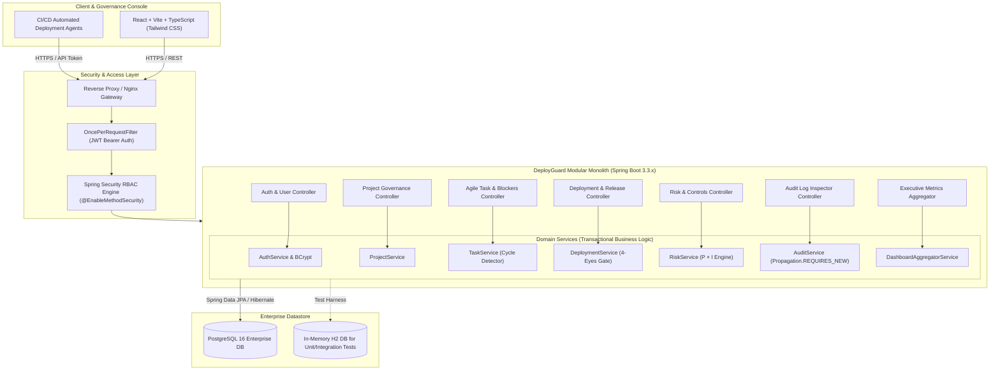
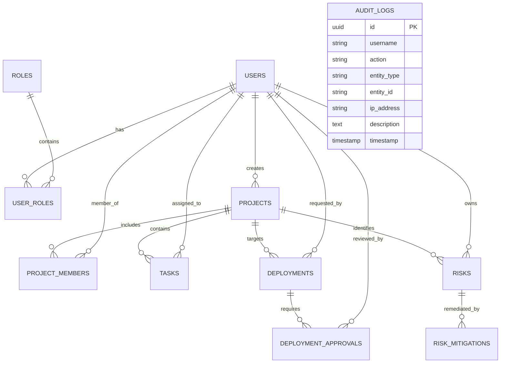

# DeployGuard — Enterprise Software Deployment, Risk & Governance Platform

DeployGuard is a production-grade software deployment, risk assessment, and release governance platform designed specifically for highly regulated enterprise and banking environments (such as Core Banking, High-Throughput Clearing, Payment Gateways, and Open Banking APIs).

It bridges the critical governance gap between agile engineering velocity and stringent regulatory compliance (SOC2 Type II, ISO 27001, PCI-DSS, and BCBS 239) by enforcing mandatory **Four-Eyes principle deployment approvals**, **automated risk scoring**, **circular-dependency-safe agile task tracking**, and an **append-only immutable audit trail**.

---

## Architecture Diagram



---

## Problem Statement

In institutional banking and tier-1 enterprise IT environments, rogue or unreviewed code changes cause severe regulatory fines, financial outages, and security breaches:
1. **Unregulated Deployments:** Engineers pushing release packages directly into production without verified reviewer sign-off.
2. **Conflict of Interest:** Lack of strict segregation of duties (engineers approving their own production releases).
3. **Hidden Systemic Risk:** Deployment velocity accelerating without quantified risk scoring (probability × impact evaluation).
4. **Audit Trail Tampering:** Incident post-mortems compromised by volatile, fragmented, or modifiable log files.

DeployGuard solves these systemic governance challenges by acting as a hardened gatekeeper for all software releases.

---

## Key Features

- **Four-Eyes Principle Governance:** Production releases strictly prohibit self-approval. A release created by a developer must be reviewed and digitally signed off by an authorized Reviewer or Administrator before execution eligibility is unlocked.
- **Automated Rollback Orchestration:** Instant single-click rollback for production releases with mandatory recorded business and technical justifications.
- **Dynamic Risk Matrix & Scoring Engine:** Automatically calculates Risk Score ($Score = Probability \times Impact$) on a scale of 1 to 25. High ($Score \ge 10$) and Critical ($Score \ge 16$) risks are prominently escalated on the executive dashboard.
- **Agile Task Execution & Dependency Cycle Detection:** Enforces topological safety by preventing self-dependencies and detecting circular blocker relationships.
- **Immutable Append-Only Compliance Audit Trail:** Records all logins, entity creations, status transitions, reviewer sign-offs, and rollbacks with principal user, timestamp, client IP, and contextual metadata.
- **Role-Based Access Control (RBAC):** Granular permission isolation across `ADMIN`, `PROJECT_MANAGER`, `DEVELOPER`, and `REVIEWER`.
- **Live Executive Dashboard:** Real-time metrics, interactive charts (Recharts), and health probes. Zero mock or hardcoded statistics.

---

## Tech Stack

### Backend
- **Java 17 / 21 LTS**
- **Spring Boot 3.3.4**
- **Spring Security 6.x** (Stateless Bearer JWT Authentication)
- **Spring Data JPA & Hibernate 6**
- **PostgreSQL 16** (with H2 in PostgreSQL compatibility mode for isolated tests)
- **Jakarta Bean Validation** (`@NotBlank`, `@Size`, `@Pattern`, `@Min`, `@Max`)
- **JJWT 0.12.6** (HMAC-SHA256 token generation & validation)
- **Spring Boot Actuator** (Observability & Health Monitoring)
- **SpringDoc OpenAPI 2.6.0 / Swagger UI**
- **Apache Maven 3.9.6**

### Frontend
- **React 19 & TypeScript**
- **Tailwind CSS v4** (Enterprise navy/slate high-contrast design system)
- **Vite 8**
- **React Router 7**
- **Axios** (Configured with request/response interceptors)
- **Recharts 3** (Interactive pipeline and risk visualizations)
- **Lucide React** (Consistent iconography)

### DevOps & Containerization
- **Docker & Docker Compose** (Multi-stage non-root container builds)
- **Nginx Alpine** (Production client reverse proxy)
- **GitHub Actions** (Automated CI/CD pipeline running linting, tests, JAR compilation, and container builds)

---

## Database Design & Entity Relationships



### Table Definitions & Constraints
- `users`: UUID primary key, unique constraints on `username` and `email`, BCrypt hashed passwords.
- `roles`: Seeded with `ROLE_ADMIN`, `ROLE_PROJECT_MANAGER`, `ROLE_DEVELOPER`, `ROLE_REVIEWER`.
- `projects`: Unique alphanumeric project key (`CSG-01`, `RTF-02`), foreign key to creator.
- `tasks`: Foreign key to project, assignee, and reporter. Self-referencing many-to-many table `task_dependencies` for blocker tracking.
- `deployments`: Foreign key to project and requester. Tracks `environment` (`DEVELOPMENT`, `TEST`, `STAGING`, `PRODUCTION`), `status`, `pipeline_run_id`, `executed_at`, `rolled_back_at`.
- `deployment_approvals`: Links deployment to reviewer with review decision (`APPROVED`, `REJECTED`), comments, and timestamp.
- `risks`: Evaluates `probability` (1-5) and `impact` (1-5), storing calculated `risk_score` (1-25) and `severity`.
- `risk_mitigations`: Granular control actions tracked to completion with owner and timestamp.
- `audit_logs`: Append-only, indexed on `timestamp`, `action`, `username`, and `entity_type`.

---

## Authentication & Authorization Matrix

| Endpoint | Method | Permitted Roles | Business & Security Controls |
| :--- | :---: | :--- | :--- |
| `/api/auth/register` | `POST` | Public | Validates email format, unique username, BCrypt password hashing. |
| `/api/auth/login` | `POST` | Public | Verifies credentials, issues signed HMAC-SHA256 JWT, logs `LOGIN`. |
| `/api/auth/me` | `GET` | Authenticated | Returns current profile, granted roles, and department. |
| `/api/projects` | `GET` | Authenticated | Paginated query with status/archived filters. |
| `/api/projects` | `POST` | `ADMIN`, `PROJECT_MANAGER` | Enforces uppercase unique key, assigns members, logs `PROJECT_CREATED`. |
| `/api/tasks` | `POST` | `ADMIN`, `PM`, `DEVELOPER` | Validates project matching, checks for circular dependencies. |
| `/api/deployments` | `POST` | `ADMIN`, `PM`, `DEVELOPER` | Production/staging environments automatically enter `UNDER_REVIEW`. |
| `/api/deployments/{id}/approve` | `POST` | `ADMIN`, `REVIEWER` | **Four-Eyes Gate:** Rejects if reviewer == requester. Unlocks execution. |
| `/api/deployments/{id}/reject` | `POST` | `ADMIN`, `REVIEWER` | Requires governance review reason, marks deployment `REJECTED`. |
| `/api/deployments/{id}/execute` | `POST` | `ADMIN`, `PM`, `DEVELOPER` | Rejects unless deployment status is `APPROVED`. |
| `/api/deployments/{id}/rollback`| `POST` | `ADMIN`, `PM`, `DEV`, `REV` | Only applicable to `SUCCESSFUL` releases; mandatory rollback reason. |
| `/api/risks` | `POST` | `ADMIN`, `PROJECT_MANAGER` | Auto-calculates risk score and severity thresholds. |
| `/api/risks/{id}/mitigations` | `POST` | `ADMIN`, `PM`, `DEVELOPER` | Records remediation actions; auto-moves risk to `MITIGATING`. |
| `/api/audit-logs` | `GET` | `ADMIN`, `REVIEWER`, `PM` | Filterable immutable audit inspection for SOC2/ISO compliance. |
| `/api/dashboard/summary` | `GET` | Authenticated | Live aggregated KPIs, charts, and activity streams. |

---

## Security Implementation

1. **Password Hashing:** Passwords hashed with BCrypt (strength 10) with salt generation. Plaintext passwords never stored or logged.
2. **Stateless JWT Tokens:** JJWT 0.12 API using HMAC-SHA256 keys, validated per request by `AuthTokenFilter`.
3. **No Sensitive Information Leaks:** Stack traces are caught by `GlobalExceptionHandler`. Consistent JSON error responses return safe HTTP statuses (`400`, `401`, `403`, `404`, `409`, `500`).
4. **Segregation of Duties (Four-Eyes Principle):** Enforced in service layer (`DeploymentServiceImpl` checks `deployment.getRequestedBy().getId().equals(reviewer.getId())`).
5. **SQL Injection Defense:** Strict use of Spring Data JPA repositories with parameterized queries and criteria specifications.
6. **CORS Hardening:** Explicitly declared origins (`localhost:5173`, `localhost:3000`, `localhost:80`). Wildcard `*` disabled.

---

## Pre-Seeded Enterprise Demo Credentials

DeployGuard automatically seeds realistic institutional demo data on startup:

| Username | Password | Role | Department | Description |
| :--- | :--- | :--- | :--- | :--- |
| `admin` | `Admin@123456` | `ROLE_ADMIN` | Enterprise IT Architecture | Complete platform authority |
| `rev_marcus` | `Password@123` | `ROLE_REVIEWER` | Release Governance & Risk Controls | Approves/rejects production deployments |
| `pm_sarah` | `Password@123` | `ROLE_PROJECT_MANAGER` | Payment Platforms Delivery | Leads projects, registers risks and tasks |
| `dev_alex` | `Password@123` | `ROLE_DEVELOPER` | Core Banking Engineering | Submits deployments, executes tasks |

*Tip: The login UI features 1-click quick prefill buttons for each profile.*

---

## Local Development Setup

### Prerequisites
- Java 17 or Java 21 LTS
- Node.js 18+ and npm
- Docker (optional for containerized runtime)

### 1. Running the Spring Boot Backend

Using the included Maven wrapper / Apache Maven:
```powershell
cd backend
mvn clean spring-boot:run
```
The backend initializes the embedded H2/PostgreSQL database, executes the `DataInitializer`, and listens on `http://localhost:8080`.

- Health Endpoint: `http://localhost:8080/actuator/health`
- Swagger OpenAPI Documentation: `http://localhost:8080/swagger-ui.html`

### 2. Running the React Frontend

```powershell
cd frontend
npm install
npm run dev
```
The frontend starts on `http://localhost:5173` with Vite's proxy automatically forwarding `/api` and `/actuator` requests to port `8080`.

---

## Running with Docker Compose

To run the complete production stack (PostgreSQL 16, Spring Boot backend, and Nginx frontend):

```bash
# 1. Create environment configuration
cp .env.example .env

# 2. Build and launch all services
docker compose up --build
```

Access Points:
- Web Application Console: `http://localhost`
- Backend API Direct: `http://localhost:8080`
- Swagger UI Documentation: `http://localhost:8080/swagger-ui.html`
- PostgreSQL Database: `localhost:5432` (user: `postgres`, password: `postgres`)

---

## Automated Testing Suite

DeployGuard includes a test harness verifying business rules:
- **Unit Tests:** Risk score matrix calculation, circular dependency prevention, and segregation of duties.
- **Integration Tests:** MockMvc testing authentication, JWT generation, invalid credentials rejection, and input validation.

To run the automated tests:
```powershell
cd backend
mvn test
```

### Test Results
```
[INFO] Running com.deployguard.controller.AuthControllerIntegrationTest
[INFO] Tests run: 7, Failures: 0, Errors: 0, Skipped: 0
[INFO] Running com.deployguard.security.JwtUtilsTest
[INFO] Tests run: 3, Failures: 0, Errors: 0, Skipped: 0
[INFO] Running com.deployguard.service.DeploymentServiceTest
[INFO] Tests run: 10, Failures: 0, Errors: 0, Skipped: 0
[INFO] Running com.deployguard.service.RiskServiceTest
[INFO] Tests run: 2, Failures: 0, Errors: 0, Skipped: 0
[INFO] Running com.deployguard.service.TaskServiceTest
[INFO] Tests run: 2, Failures: 0, Errors: 0, Skipped: 0
[INFO] -------------------------------------------------------
[INFO] Results: Tests run: 24, Failures: 0, Errors: 0, Skipped: 0
[INFO] BUILD SUCCESS
```

---

## Security Architecture & Quality Engineering

1. **Privilege Escalation Protection:**  
   Public registration (`/api/auth/register`) strictly assigns `ROLE_DEVELOPER` and ignores any client-supplied roles in the payload. Administrative privilege modification is sequestered to `PUT /api/users/{id}/roles` protected by `@PreAuthorize("hasRole('ADMIN')")`.

2. **Cryptographic Key & Secret Hardening:**  
   The platform requires an externally configured `JWT_SECRET` in production with zero hardcoded fallbacks in `application.yml` or `docker-compose.yml`. At startup, `JwtUtils` executes a `@PostConstruct` validation enforcing a minimum of 256 bits (32 bytes) for HMAC-SHA algorithms, failing fast if the key is missing or weak.

3. **Deployment Workflow & Four-Eyes Principle:**  
   - Requester cannot approve their own deployment request (enforced in service layer).
   - Unapproved deployments cannot execute (`BadRequestException`).
   - Deployments to `PRODUCTION` and `STAGING` automatically enter `UNDER_REVIEW`.
   - Rollback strictly requires a `SUCCESSFUL` deployment and a nonblank reason.
   - Non-members and unauthorized users cannot mutate deployments or deploy to archived projects.

4. **Audit Trail Integrity:**  
   Standard business audit logging uses `Propagation.REQUIRED` so that if a business transaction encounters an error and rolls back, the audit log rolls back atomically, preventing phantom or misleading audit entries. Dedicated security incident logging uses `Propagation.REQUIRES_NEW`.

5. **N+1 Query Prevention:**  
   Repositories (`DeploymentRepository`, `TaskRepository`, `RiskRepository`) use JPA `@EntityGraph` mappings to eagerly fetch associations in single SQL joins during pagination and specification queries.

6. **Automated Secret Detection & Pre-Commit Hardening:**  
   The repository includes a dedicated secret scanner (`scripts/scan-secrets.ps1`) and git pre-commit hook (`.githooks/pre-commit`). GitHub Actions CI automatically runs Gitleaks to enforce that verified credentials immediately break the pipeline.

---

## Secret Rotation & Incident Response Runbook

In the event of suspected or confirmed credential exposure:

1. **Immediate Revocation & Invalidation:**  
   Immediately revoke the compromised credential in the identity provider or database management console. Never assume a credential is secure because a repository was private.
2. **Access Log & Audit Inspection:**  
   Review cloud provider audit logs (AWS CloudTrail, GitHub Audit Log, database query audit) and DeployGuard's immutable audit trail (`/api/audit-logs`) to determine if the compromised key was leveraged for unauthorized actions.
3. **Purge Exposure from Source:**  
   Replace any hardcoded values with environment variable references (`${VAR}`) and update `.env.example` with sanitized placeholders.
4. **Update Approved Secret Store:**  
   Inject the newly rotated credential into the enterprise secrets manager (e.g. AWS Secrets Manager, HashiCorp Vault, Kubernetes Secret, or GitHub Actions Secrets).
5. **Redeploy Affected Services:**  
   Trigger an automated rolling deployment across all clusters to distribute the newly rotated credential and discard running instances holding old tokens in memory.
6. **Git History Remediation (If Necessary):**  
   If an untrusted commit has leaked credentials onto a remote branch, execute history sanitization via `git-filter-repo`:
   ```bash
   git filter-repo --replace-text <(echo "leaked_secret==>REDACTED_SECRET")
   git push origin main --force
   ```
7. **Verification & Proof of Invalidation:**  
   Test the revoked credential against the target endpoint to mathematically prove that previous authentication tokens now return `401 Unauthorized`.

---

## Project Structure

```
DeployGuard/
├── .github/
│   └── workflows/
│       └── ci.yml                     # Automated GitHub Actions Pipeline
├── backend/
│   ├── Dockerfile                     # Multi-stage Java Dockerfile
│   ├── pom.xml                        # Maven dependencies & build plugins
│   └── src/
│       ├── main/
│       │   ├── java/com/deployguard/
│       │   │   ├── audit/             # Immutable audit logging engine
│       │   │   ├── config/            # Security, OpenAPI & Data Initializer
│       │   │   ├── controller/        # REST Controllers
│       │   │   ├── dto/               # Request & Response DTOs
│       │   │   ├── entity/            # JPA Entities & Enums
│       │   │   ├── exception/         # Centralized GlobalExceptionHandler
│       │   │   ├── mapper/            # Type-safe Entity-to-DTO Mappers
│       │   │   ├── repository/        # Spring Data JPA Repositories
│       │   │   ├── security/          # JWT Utils, Filter & UserDetails
│       │   │   └── service/           # Domain Services & Implementations
│       │   └── resources/
│       │       └── application.yml    # PostgreSQL & JWT Configuration
│       └── test/
│           ├── java/com/deployguard/  # Controller & Service Test Suites
│           └── resources/
│               └── application-test.yml # In-memory H2 Test Profile
├── frontend/
│   ├── Dockerfile                     # Multi-stage React/Nginx Dockerfile
│   ├── nginx.conf                     # Nginx routing & API proxy configuration
│   ├── package.json                   # React, Tailwind, Recharts dependencies
│   ├── vite.config.ts                 # Vite bundler & backend proxy config
│   └── src/
│       ├── components/                # Badges, Modals, Navbar, Sidebar
│       ├── context/                   # AuthContext & RBAC state
│       ├── pages/                     # Dashboard, Projects, Tasks, Deployments, Risks, Audits
│       ├── services/                  # Axios API client modules
│       └── types/                     # TypeScript domain interfaces
├── docker-compose.yml                 # Orchestration (Postgres + Backend + Frontend)
├── .env.example                       # Environment configuration template
└── README.md                          # Platform documentation
```
